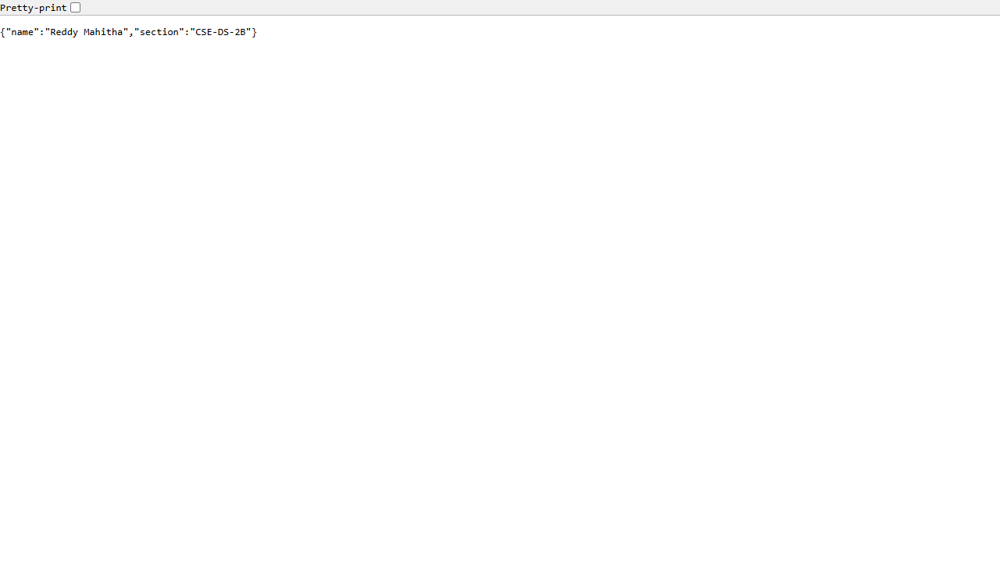
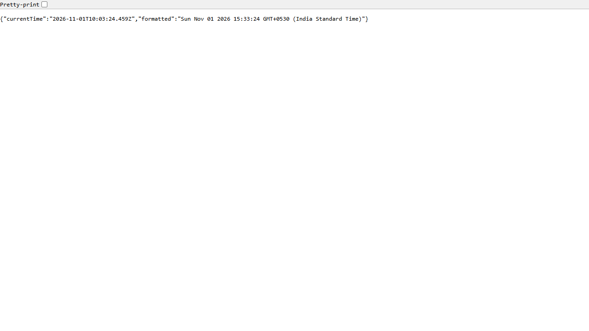

# Lab 01: Node.js and Express Server

> **Deployed Live URL:** `https://lab-01-1gpc.onrender.com` **

---

## 1. Student Information

| Field | Details |
| :--- | :--- |
| **Student Name** | Reddy Mahitha |
| **Registration Number** | 252U1R3079 |
| **Section** | CSE-DS-2B |
| **Lab Number** | 01 |
| **Lab Title** | Node.js and Express Server |

---

## 2. Project Objective

The primary objectives of this laboratory assignment are:
1. To understand the fundamentals of server-side JavaScript execution using Node.js.
2. To explore the built-in `http` module of Node.js and construct a raw HTTP server without third-party frameworks.
3. To introduce **Express.js**, understand its architecture, routing capabilities, and middleware pipeline.
4. To implement standard RESTful HTTP endpoints returning both plain text and JSON responses.
5. To configure routing fallbacks using a custom 404 middleware.
6. To prepare a Node.js web application for production deployment on platforms such as Render using dynamic port bindings (`process.env.PORT || 3000`).

---

## 3. Technologies Used

- **Node.js (v24+)**: JavaScript runtime environment executed outside the browser.
- **Express.js (v4.21+)**: Fast, minimalist web framework for Node.js handling HTTP requests, routing, and middleware.
- **JavaScript (CommonJS / ES6)**: Standard syntax using `require()` and modern JavaScript constructs.
- **npm (Node Package Manager)**: Dependency management and script runner.
- **Google Chrome (Headless)**: Used for automated browser rendering validation and real screenshot capture.

---

## 4. Environment Variables

> **Note:** No external environment variables or `.env` files are required for local execution.
> 
> The application is pre-configured with a fallback mechanism:
> ```javascript
> const PORT = process.env.PORT || 3000;
> ```
> When hosted on cloud platforms like Render, the cloud runtime automatically injects the `PORT` environment variable.

---

## 5. Installation Instructions

Follow these steps to set up the project locally:

1. **Clone or Navigate to the Repository:**
   ```bash
   cd lab-01
   ```

2. **Verify Node.js and npm Installation:**
   ```bash
   node -v
   npm -v
   ```

3. **Install Dependencies:**
   Install required packages (Express) defined in `package.json`:
   ```bash
   npm install
   ```

---

## 6. How to Run the Servers

### A. Running the Basic Node.js HTTP Server (`basic-server.js`)

To execute the raw server built using Node's built-in `http` module:
```bash
node basic-server.js
```
*or via npm:*
```bash
npm run basic
```

**Expected Terminal Output:**
```text
Basic HTTP server running on port 3000
```
Open your browser and navigate to: [http://localhost:3000](http://localhost:3000) (Response: `Hello`).

---

### B. Running the Express Server (`server.js`)

To execute the Express application:
```bash
npm start
```
*or directly with node:*
```bash
node server.js
```

**Expected Terminal Output:**
```text
Express server running on port 3000
```

---

## 7. Endpoint Documentation

The Express server exposes the following endpoints:

| HTTP Method | Endpoint | Description | Status Code | Content Type | Response Body |
| :--- | :--- | :--- | :---: | :--- | :--- |
| `GET` | `/` | Welcome banner route | `200 OK` | `text/html; charset=utf-8` | `Welcome to Node.js and Express Server!` |
| `GET` | `/about` | Returns student identification details | `200 OK` | `application/json; charset=utf-8` | `{"name":"Reddy Mahitha","section":"CSE-DS-2B"}` |
| `GET` | `/time` | Returns the current server date and time | `200 OK` | `application/json; charset=utf-8` | `{"currentTime":"...","formatted":"..."}` |
| `ALL` | `*` *(any undefined)* | Catch-all 404 middleware | `404 Not Found` | `text/html; charset=utf-8` | `404 - Page Not Found` |

---

## 8. HTTP Status Codes Used

- **`200 OK`**: Standard HTTP response indicating that the client's request succeeded. Used for `/`, `/about`, and `/time`.
- **`404 Not Found`**: Standard client-side error status indicating that the requested URL does not match any route defined on the server. Used for any undefined path (e.g. `/invalid`).

---

## 9. Endpoint Screenshots

All screenshots below were captured from an actual browser instance accessing the live Express server on port 3000.

### 1. Home Endpoint (`GET /`)
URL: `http://localhost:3000/`  
Expected Output: `Welcome to Node.js and Express Server!` (Status: 200)


---

### 2. About Endpoint (`GET /about`)
URL: `http://localhost:3000/about`  
Expected Output: JSON containing student name and section (Status: 200)



---

### 3. Time Endpoint (`GET /time`)
URL: `http://localhost:3000/time`  
Expected Output: JSON containing current timestamp generated with `new Date()` (Status: 200)



---

### 4. 404 Not Found Endpoint (`GET /invalid`)
URL: `http://localhost:3000/invalid`  
Expected Output: `404 - Page Not Found` (Status: 404)


---

## 10. Problems Faced and Solutions

| Problem Encountered | Cause | Solution Implemented |
| :--- | :--- | :--- |
| **Port Conflict (`EADDRINUSE`)** | Attempting to start `server.js` while `basic-server.js` or an existing process is already listening on port 3000. | Stopped the background Node process before launching the Express server, and configured dynamic port switching (`process.env.PORT || 3000`). |
| **404 Middleware Intercepting Valid Routes** | Placing the catch-all middleware (`app.use()`) before route declarations causes every request to return 404. | Placed the 404 handler at the bottom of `server.js`, after all valid route definitions (`/`, `/about`, `/time`). |
| **Accidental node_modules Tracking in Git** | Running `git add .` without an appropriate `.gitignore` stages thousands of third-party package files. | Created a `.gitignore` specifying `node_modules/` and `.env` before running any Git commands. |
| **Cloud Deployment Port Hardcoding** | Hardcoding `app.listen(3000)` causes applications to fail on platforms like Render that assign dynamic ports. | Implemented `process.env.PORT || 3000` to allow the platform environment to inject the listening port automatically. |

---

## 11. Conclusion

In this lab assignment, we successfully:
- Built a native Node.js HTTP server demonstrating how the runtime handles network requests via low-level streams and callbacks.
- Migrated to the Express.js framework, appreciating how its abstraction simplifies routing, status code setting, and JSON serialization.
- Validated all route behaviors and HTTP status codes using automated tests and verified responses via real browser screenshots.
- Structured the project following clean code, minimal dependency, and cloud-ready standards.

---


## 12. Deployment Instructions (Render)

To deploy this project as a live web service on [Render](https://render.com):

1. **Push your code to GitHub** inside your `nodejs-course` repository:
   ```bash
   git add lab-01/
   git commit -m "feat(lab-01): complete lab 01 Node.js and Express server"
   git push origin main
   ```
2. **Log into Render:** Navigate to [dashboard.render.com](https://dashboard.render.com).
3. **Create a New Web Service:**
   - Click **New +** > **Web Service**.
   - Connect your GitHub repository.
4. **Configure the Web Service Settings:**
   - **Name:** `lab-01-express-server` (or preferred name).
   - **Root Directory:** `lab-01` (since the project resides inside the `lab-01` subfolder of your repository).
   - **Runtime:** `Node`.
   - **Build Command:** `npm install`.
   - **Start Command:** `npm start` (or `node server.js`).
   - **Plan:** Free.
5. **Deploy:**
   - Click **Create Web Service**.
   - Render will clone the repository, install Express, set `process.env.PORT`, and launch the server.
   - Once the status shows **Live**, copy your URL (e.g. `https://lab-01-xxxx.onrender.com`) and update the placeholder link at the top of this `README.md`.
